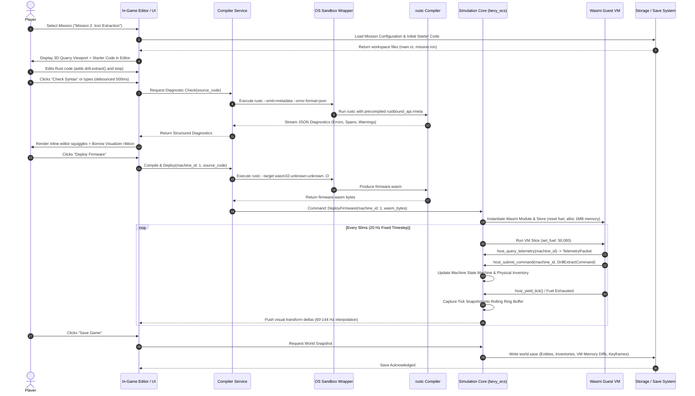
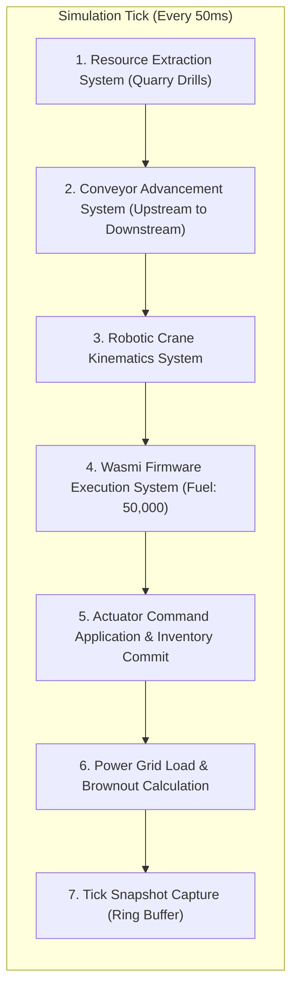

# Rustbound: Technical Architecture Lock

**Document ID:** `ARCH-001`  
**Status:** LOCKED & AUTHORITATIVE  
**Version:** 1.0.0  
**Target Date:** November 2026  
**Primary Engine:** Bevy (v0.20+)  
**Primary Language:** Rust (Edition 2024 / rustc 1.86+)  
**Target Platforms:** Windows 10/11 (x86_64), Linux Desktop (x86_64), Steam Deck (SteamOS 3.x)

---

## 1. Executive Architecture Decision

**Rustbound: The Systems Frontier** is an industrial automation simulation and systems-programming game set on the hostile, resource-rich world of Aethelgard. The player plays as an automation engineer tasked with re-activating derelict industrial complexes, programming mining drills, conveyor sorters, robotic gantry cranes, and chemical synthesizers using actual Rust code.

To fulfill this mission with professional software engineering rigor, the architecture is designed around three non-negotiable core pillars:

1. **Authentic Rust Integration Without Compromise:**  
   Players write real, standard Rust code. Code is compiled by the official Rust compiler (`rustc`) targeting `wasm32-unknown-unknown` with `#![no_std]`. Real diagnostics, error codes (`E0382`, `E0502`, `E0308`), span annotations, and suggestions are surfaced directly in the in-game IDE.
2. **Deterministic, Headless Simulation:**  
   Simulation logic is decoupled from graphics. Implemented in a dedicated headless crate (`rustbound_sim`) using `bevy_ecs`, the simulation runs at a fixed **20 Hz** (50 ms) timestep using discrete grid integer coordinates and fixed-point conveyor mechanics. IEEE-754 floating-point operations are strictly banned in the simulation core, guaranteeing bit-for-bit execution determinism across Windows, Linux, and Steam Deck.
3. **Dual Sandboxed Security Boundaries:**  
   The system implements two independent, airtight isolation boundaries:
   - **Compiler Boundary:** `rustc` runs as an isolated OS worker process restricted by OS resource quotas (`setrlimit` on Linux, Job Objects on Windows) with hard memory (1GB) and execution time (5,000 ms) limits.
   - **Guest Runtime Boundary:** Compiled firmware executes inside **`wasmi` (v2.0)**, a lightweight, deterministic WebAssembly interpreter with strict instruction fuel metering (50,000 fuel units/tick) and memory page caps (4MB max). The guest cannot access host memory, filesystems, network interfaces, or OS system calls.

---

## 2. Technology Decision Matrix

| Subsystem Component | Selected Technology | Verified Version | Alternative Candidates Evaluated | Rationale for Selection | Known Limitations | Upgrade & Governance Policy | Official Documentation |
| :--- | :--- | :---: | :--- | :--- | :--- | :--- | :--- |
| **Game Engine** | **Bevy Engine** | `0.20+` | Godot 4.x (GDExtension), Fyrox, Macroquad | Pure Rust ECS; zero-overhead headless decoupling (`bevy_ecs`); multi-threaded system scheduling. | Fast API churn across minor versions; scene editor tooling still maturing. | Pin exact version in `Cargo.lock`. Upgrades require an ADR and presentation-layer test pass. | [bevyengine.org](https://bevyengine.org/learn/) |
| **Guest VM Runtime** | **Wasmi** | `2.0.0` | Wasmtime 51.0, Wasmer, V8 | Guaranteed bit-for-bit determinism (`deterministic` feature); native fuel metering; <64KB overhead per instance; instant deployment (0ms JIT lag). | ~10-20x slower than JIT compilation (negligible for 20Hz machine state logic). | Pin minor version; verify against WebAssembly spec test suites. | [docs.rs/wasmi](https://docs.rs/wasmi/) |
| **Compilation Toolchain** | **rustc (direct invocation)** | `1.86+ / 1.99+` | `cargo build`, embedded `librustc_driver` | Sub-500ms single-file compile times; eliminates Cargo `build.rs` and proc-macro execution vulnerabilities; direct JSON diagnostics streaming. | Cannot resolve arbitrary `Cargo.toml` dependencies (intentional design constraint). | Bundle minimal sysroot (`rust-std-wasm32-unknown-unknown`) with client; match game patch cycles. | [doc.rust-lang.org/rustc](https://doc.rust-lang.org/rustc/) |
| **Compilation Target** | **wasm32-unknown-unknown** | Standard Tier 2 | wasm32-wasip1, native dynamic libraries | Generates standalone WebAssembly with zero OS syscall imports; built-in LLD linker support; pure `#![no_std]` compatibility. | Requires `#![no_std]` or custom memory allocators for advanced collections. | Managed via rustup toolchain configuration. | [rust-lang.org](https://doc.rust-lang.org/nightly/rustc/platform-support/wasm32-unknown-unknown.html) |
| **In-Game Editor UI** | **bevy_egui + egui_dock** | `0.43+ / 0.21+` | Native `bevy_ui`, embedded `ra_ap_ide`, Slint | High-performance immediate-mode docking windows; rich text styling; sub-80MB memory footprint. | Immediate-mode redraws every frame if not cached; custom text layout needed for large files. | Lockstep upgrade with Bevy engine updates. | [github.com/vladimiroff/bevy_egui](https://github.com/vladimiroff/bevy_egui) |
| **Text Buffer Engine** | **ropey** | `2.0.0` | `std::string::String`, `im-rc`, `gap-buffer` | Immutable piece-tree rope structure; O(log N) insertion/deletion; fast line-to-char indexing. | Small memory overhead for very short strings (< 100 bytes). | Stable crate; upgrade upon semantic major releases. | [docs.rs/ropey](https://docs.rs/ropey/) |
| **Syntax Highlighting** | **tree-sitter-rust** | `0.23+` | Syntect / Sublime syntaxes, regex lexer | Incremental AST parsing; sub-millisecond re-highlighting on typing; accurate semantic tokens. | Requires C runtime binding or pure Rust bindings. | Pin version; maintain grammar file compatibility. | [github.com/tree-sitter/tree-sitter-rust](https://github.com/tree-sitter/tree-sitter-rust) |
| **Serialization / ABI** | **zerocopy + POD structs** | `0.8+` | `serde_json`, `postcard`, `bincode` | Zero serialization overhead; direct byte-casting of fixed-size telemetry packets across FFI. | Requires repr(C) / repr(transparent) and manual layout padding discipline. | Strict adherence to `zerocopy` derive rules and safety guidelines. | [docs.rs/zerocopy](https://docs.rs/zerocopy/) |

---

## 3. System Architecture Diagram

```mermaid
graph TD
    subgraph PresentationLayer ["Presentation Layer (Client)"]
        BEVY_APP["Bevy App (Client Entrypoint)"]
        VIEWPORT["3D Game Viewport (bevy_render / wgpu)"]
        UI_DOCK["Docking Workspace (bevy_egui / egui_dock)"]
        EDITOR["In-Game Code Editor (ropey / tree-sitter)"]
        BORROW_VIZ["Borrow Visualizer Panel"]
        DIAG_PANEL["Compiler Diagnostics Panel"]
    end

    subgraph CompilerSubsystem ["Compiler Subsystem (Isolated Worker)"]
        COMPILER_SVC["Compiler Service (Watcher / Scheduler)"]
        SANDBOX_WRAPPER["OS Sandbox Wrapper (setrlimit / Job Objects)"]
        RUSTC_BIN["rustc (wasm32-unknown-unknown)"]
        SDK_RLIB["Precompiled rustbound_api.rlib"]
        JSON_PARSER["Rustc JSON Diagnostics Parser"]
    end

    subgraph SimulationSubsystem ["Simulation Subsystem (Headless bevy_ecs)"]
        SIM_CORE["Simulation Core (Fixed 20 Hz Schedule)"]
        GRID_WORLD["Grid Spatial Model (Integer TileCoord)"]
        CONVEYOR_SYS["Conveyor System (Fixed-point SubTileProgress)"]
        MACHINE_ECS["Machine State Machines (Drill, Crane, Storage)"]
        SNAPSHOT_MGR["Snapshot Manager (60-Tick Ring Buffer / Keyframes)"]
    end

    subgraph RuntimeSubsystem ["Guest Execution Runtime (Wasmi)"]
        WASMI_POOL["Wasmi Runtime Pool (Instance per Machine)"]
        FUEL_METER["Instruction Fuel Metering (50k fuel / tick)"]
        HOST_ABI["Host/Guest ABI Dispatcher"]
        PHYS_CUSTODY["Physical Custody Token Validator"]
    end

    %% presentation to editor & compiler
    EDITOR -->|Source Code Changes| COMPILER_SVC
    COMPILER_SVC -->|Spawns Subprocess| SANDBOX_WRAPPER
    SANDBOX_WRAPPER -->|Invokes with SDK| RUSTC_BIN
    SDK_RLIB -.->|Linked into| RUSTC_BIN
    RUSTC_BIN -->|JSON Diagnostics Stream| JSON_PARSER
    JSON_PARSER -->|Error Spans & Codes| DIAG_PANEL
    JSON_PARSER -->|Borrow Spans E0382/E0502| BORROW_VIZ

    %% compilation to deployment
    RUSTC_BIN -->|Outputs firmware.wasm| COMPILER_SVC
    COMPILER_SVC -->|Deploys Bytecode| WASMI_POOL

    %% runtime to simulation
    SIM_CORE -->|Tick 20 Hz (Allocates Fuel)| WASMI_POOL
    WASMI_POOL -->|Checks Budget| FUEL_METER
    WASMI_POOL <-->|C-ABI FFI Calls| HOST_ABI
    HOST_ABI <-->|Validate & Transfer Custody| PHYS_CUSTODY
    PHYS_CUSTODY <-->|Read / Write Machine State| MACHINE_ECS

    %% simulation internal
    MACHINE_ECS <-->|Transfer Items| CONVEYOR_SYS
    CONVEYOR_SYS <-->|Move Across Grid| GRID_WORLD
    SIM_CORE -->|Every Tick| SNAPSHOT_MGR

    %% simulation to presentation
    SIM_CORE -.->|Interpolated Transforms| VIEWPORT
    MACHINE_ECS -.->|Telemetry Snapshots| UI_DOCK
```

---

## 4. Execution Lifecycle & Dataflow

The lifecycle of an engineering session in Rustbound proceeds through nine strictly defined stages:



### Stage Details:
1. **Open Mission:** Simulation loads the mission's RON manifest, instantiating the grid layout, derelict machines, and initial inventory chests.
2. **Load Workspace:** The player's scratchpad file (`main.rs`) is loaded from `saves/missions/<id>/code/main.rs` into the `ropey` text buffer.
3. **Edit Program:** The player writes Rust code. Syntax highlighting updates immediately via `tree-sitter-rust`.
4. **Diagnostic Check:** Debounced background syntax checking invokes `rustc` in fast metadata-only check mode (`-Z no-codegen` or `--emit=metadata`). Structured JSON diagnostics are mapped to buffer spans.
5. **Compile Program:** Clicking "Deploy" invokes full `rustc` code generation, outputting a compact, optimized `firmware.wasm` module (< 15 KB).
6. **Deploy Firmware:** The compiled bytecode is transferred across a thread-safe MPSC channel to the simulation thread, which instantiates a fresh Wasmi instance inside the target machine entity.
7. **Execute in Runtime:** At every 20 Hz tick, the simulation allocates 50,000 fuel units to the VM and invokes `firmware_main`. The guest runs until it calls `host_yield_tick()` or depletes its fuel budget.
8. **Update Machine State:** Actuator commands submitted during the tick are validated and applied to ECS machine components. Physical resources advance along conveyors.
9. **Save Simulation:** The complete world state, entity components, and Wasmi linear memory page diffs are serialized to disk using compact binary keyframes.

---

## 5. Compiler Architecture & Subprocess Isolation

### 5.1 Invocation Specification

The compiler service invokes `rustc` directly using standard OS process primitives (`std::process::Command`), deliberately bypassing `cargo` to ensure sub-second compilation and prevent arbitrary build script execution.

```bash
rustc \
  --target wasm32-unknown-unknown \
  --crate-type cdylib \
  --edition 2024 \
  -C opt-level=z \
  -C panic=abort \
  -C lto=thin \
  -C codegen-units=1 \
  --extern rustbound_api=/path/to/sysroot/librustbound_api.rlib \
  --error-format=json \
  --json=diagnostic-rendered-ansi,artifacts \
  --out-dir /path/to/scratch/build/ \
  /path/to/scratch/build/player_source.rs
```

### 5.2 Precompiled SDK Linking Strategy
To eliminate compilation overhead, the `rustbound_api` SDK is precompiled during the game's release build into:
1. `librustbound_api.rlib`: Pre-compiled object code linked by `rust-lld`.
2. `librustbound_api.rmeta`: Pre-compiled metadata used for fast syntax and type checking.

Player code compiles in **under 350 milliseconds** because the compiler only parses and type-checks the player's single source file.

### 5.3 Diagnostic Parsing Pipeline
`rustc` emits JSON diagnostic lines to stderr. The compiler service deserializes these into structured Rust types:

```rust
#[derive(Deserialize, Debug, Clone)]
pub struct RustcDiagnostic {
    pub message: String,
    pub code: Option<DiagnosticCode>,
    pub level: DiagnosticLevel,
    pub spans: Vec<DiagnosticSpan>,
    pub children: Vec<RustcDiagnostic>,
    pub rendered: Option<String>,
}

#[derive(Deserialize, Debug, Clone)]
pub struct DiagnosticCode {
    pub code: String, // e.g., "E0382", "E0502"
    pub explanation: Option<String>,
}

#[derive(Deserialize, Debug, Clone)]
pub struct DiagnosticSpan {
    pub file_name: String,
    pub byte_start: u32,
    pub byte_end: u32,
    pub line_start: usize,
    pub line_end: usize,
    pub column_start: usize,
    pub column_end: usize,
    pub is_primary: bool,
    pub label: Option<String>,
    pub suggested_replacement: Option<String>,
}
```

The parsed diagnostics are converted into:
- Visual red/yellow squiggles in the `ropey` editor buffer.
- Actionable entries in the "Compiler Output" tab.
- Custody ribbon connections in the Borrow Visualizer when error code is `E0382` (use of moved value) or `E0502` (mutable borrow conflict).

---

## 6. Execution Security Architecture & Threat Model

Player code is arbitrary user-written Rust executed on the player's personal machine. We distinguish between **Compiler-Time Threats** and **Runtime Threats**:

### 6.1 Threat Mitigation Matrix

| Threat Category | Specific Attack Vector | Impact | Subsystem | Mandatory Architectural Mitigation |
| :--- | :--- | :---: | :--- | :--- |
| **Compiler DoS** | Deep type recursion (`#![recursion_limit="100000000"]`) | Host CPU Freeze / OOM | Compiler Subsystem | Subprocess memory limit (1GB) and hard execution watchdog (5,000 ms). Process killed on breach. |
| **Compiler DoS** | Massive macro expansion bomb (`macro_rules!`) | Compiler Crash / Hang | Compiler Subsystem | Process timeout (5s); macro expansion depth restricted via compiler invocation flags. |
| **Compiler RCE** | Arbitrary build scripts (`build.rs`) or proc-macros | Remote Code Execution | Compiler Subsystem | Direct `rustc` invocation. No `Cargo.toml`, no build scripts, no procedural macros permitted in player code. |
| **Compiler Escape** | Crate attribute abuse (`#![link_args]`, `#[no_core]`) | Linker Hijacking | Compiler Subsystem | Source sanitizer scans AST before compilation; rejects forbidden inner attributes with a helpful security explanation. |
| **Runtime Freeze** | Infinite loop (`loop {}`) or massive computation | Simulation Freeze | Runtime Subsystem | Wasmi instruction fuel metering. VM allocated 50,000 fuel units per tick. Depleted fuel pauses VM until next tick. |
| **Runtime OOM** | Guest allocates massive buffers (`Vec::with_capacity(1GB)`) | Host Memory Exhaustion | Runtime Subsystem | Wasmi linear memory constrained to 16 initial pages (1MB) and 64 max pages (4MB). Allocation past 4MB traps safely. |
| **Runtime Trap** | Explicit panic, integer divide by zero, unreachable | Host Process Panic | Runtime Subsystem | Wasmi catches Wasm traps cleanly as `Result::Err(Trap)`. Machine enters "Fault / Rebooting" state; host never panics. |
| **Host Corruption** | Guest passes invalid memory pointer to host FFI | Host Memory Overwrite | Host/Guest ABI | Host validates that `ptr + len <= guest_memory_size` before copying any slice. Zero host pointers exposed to guest. |
| **Sandbox Escape** | Guest attempts file/socket/network I/O | Host System Tampering | Runtime Subsystem | `wasm32-unknown-unknown` target. Zero WASI imports provided by host. Network and filesystem syscalls are physically nonexistent in VM. |
| **Save Tampering** | Corrupted or maliciously crafted world save file | Buffer Overflow on Load | Save Subsystem | Save files use strictly typed RON / binary formats with CRC32 integrity checksums and length-checked array decoders. |

---

## 7. Host/Guest Protocol & Physical Custody ABI

### 7.1 Protocol Architecture

The communication boundary is strictly isolated through a minimal C-ABI FFI layer (`rustbound_sys`). All data exchanged between the host simulation and the guest firmware consists of compact, fixed-size Plain-Old-Data (POD) packets marked with `#[repr(C)]`.

### 7.2 Low-Level C-ABI Functions

The host registers four foreign functions into the Wasmi import linker under module name `"rustbound_sys"`:

```rust
// Foreign function declarations imported by the guest Wasm module
extern "C" {
    /// Queries machine status into guest memory buffer.
    /// Returns number of bytes written, or negative error code.
    pub fn host_query_telemetry(machine_id: u32, out_ptr: *mut u8, max_len: u32) -> i32;

    /// Submits an actuator command packet from guest memory buffer.
    /// Returns 0 on success, or negative error code.
    pub fn host_submit_command(machine_id: u32, cmd_ptr: *const u8, cmd_len: u32) -> i32;

    /// Voluntarily yields remaining fuel for the current simulation tick.
    pub fn host_yield_tick();

    /// Emits a debug log message to the machine's in-game terminal.
    pub fn host_log(level: u32, msg_ptr: *const u8, msg_len: u32);
}
```

### 7.3 Binary Packet Headers & Memory Discipline

All command packets share a 4-byte standard packet header:
```rust
#[repr(C)]
#[derive(Copy, Clone, Debug, PartialEq, Eq)]
pub struct PacketHeader {
    pub magic: [u8; 2],  // b"RB" (RustBound)
    pub version: u8,     // Protocol version (currently 1)
    pub command_id: u8,  // Specific actuator command ID
}
```

#### Command Packet Example: `QuarryDrillCommand`
```rust
#[repr(C)]
#[derive(Copy, Clone, Debug)]
pub struct DrillExtractCommand {
    pub header: PacketHeader, // magic: b"RB", version: 1, command_id: 10
    pub target_vein_id: u32,  // 0 = Default surface seam
    pub power_setting: u8,    // 0 = Off, 1 = Low, 2 = Nominal, 3 = Overdrive
    pub _reserved: [u8; 3],   // Explicit padding to 12 bytes
}
```

### 7.4 Safe Idiomatic SDK: Physical Custody Through Move Semantics

The `rustbound_api` SDK wraps the low-level FFI into safe Rust abstractions. Resources are modeled as linear tokens that cannot be cloned:

```rust
// Core linear resource token in rustbound_api
pub struct ResourceChunk<T: ResourceKind> {
    id: u64,
    grade: OreGrade,
    _marker: core::marker::PhantomData<T>,
}

// Marker traits
pub trait ResourceKind {}
pub struct IronOre;
impl ResourceKind for IronOre {}
pub struct CopperOre;
impl ResourceKind for CopperOre {}

// Machine driver for the Quarry Drill
pub struct QuarryDrill {
    id: u32,
}

impl QuarryDrill {
    pub fn bind(machine_id: u32) -> Result<Self, DeviceError> {
        // Queries telemetry to ensure machine is accessible and operational
        Ok(Self { id: machine_id })
    }

    /// Extracts an ore chunk from the subterranean vein.
    /// Returns an owned ResourceChunk token representing physical custody.
    pub fn extract(&self) -> Result<ResourceChunk<IronOre>, MachineError> {
        // Encodes DrillExtractCommand, calls host_submit_command FFI,
        // receives unique token ID from host telemetry response.
        Ok(ResourceChunk {
            id: 1001,
            grade: OreGrade::Standard,
            _marker: core::marker::PhantomData,
        })
    }
}

// Machine driver for the Conveyor Belt
pub struct ConveyorBelt {
    id: u32,
}

impl ConveyorBelt {
    pub fn bind(machine_id: u32) -> Result<Self, DeviceError> {
        Ok(Self { id: machine_id })
    }

    /// Feeds an ore chunk onto the conveyor intake slot.
    /// Consumes the ResourceChunk BY VALUE, transferring custody to the belt!
    pub fn feed<T: ResourceKind>(&self, item: ResourceChunk<T>) -> Result<(), MachineError> {
        // item is moved into this function and dropped.
        // FFI command transfers custody to the conveyor's ECS slot.
        Ok(())
    }
}
```

---

## 8. Simulation Design & Fixed Timestep Mechanics

### 8.1 20 Hz Fixed Timestep Schedule

The simulation advances in discrete intervals of **50 milliseconds** (20 Hz). 



### 8.2 Determinism Rules
To guarantee 100% bit-for-bit replay reproducibility across all platforms:
1. **Zero Floats in Simulation:** All entity positions, speeds, temperatures, power levels, and capacities are stored as integers (`i32`, `u32`, `i64`).
2. **Topological Conveyor Ordering:** Conveyor slots are updated strictly from exit to entry (downstream to upstream). This prevents teleportation or multi-tile compression within a single tick.
3. **Strict Machine Iteration Ordering:** When executing Wasmi firmware instances, machines are sorted by their immutable `MachineId(u32)` ascending, eliminating hash-map iteration non-determinism.
4. **Deterministic Pseudo-Random Number Generation:** Any procedural element (e.g., ore vein purity variance) uses a deterministic ChaCha8 or PCG generator seeded strictly from the mission seed + tick count.

### 8.3 Snapshot & Rewind Architecture

```
Snapshot Storage Model:
├── In-Memory Rolling Ring Buffer: Last 60 ticks (3.0 seconds) stored in RAM.
│   └── Memory Footprint: ~10 KB / tick * 60 = ~600 KB total.
│   └── Supports instant, lag-free single-tick pause / step-back debugging.
└── Periodic Keyframes: Full world snapshot captured every 200 ticks (10.0 seconds).
    └── Keyframe includes: Entity state, grid tiles, Wasmi linear memory byte dump.
    └── Replay of historical execution loads nearest keyframe + fast-forwards input journal.
```

---

## 9. Workspace Architecture & Module Responsibilities

The codebase is organized as a Cargo workspace with clean modular crate boundaries. Microservice patterns and excessive abstractions are strictly rejected in favor of high-performance internal library crates.

```text
Rustbound/
├── Cargo.toml                      # Workspace root manifest
├── Cargo.lock                      # Pinned dependency versions
├── AGENTS.md                       # Development constitution & agent rules
│
├── crates/
│   ├── rustbound_client/           # Client presentation & Bevy application
│   │   ├── Cargo.toml
│   │   └── src/
│   │       ├── main.rs             # Application entrypoint
│   │       ├── plugins/            # Bevy plugins (render, audio, camera)
│   │       ├── ui/                 # bevy_egui docking windows & inspectors
│   │       ├── editor/             # ropey buffer, tree-sitter highlighter
│   │       └── visualizers/        # Borrow visualizer & custody ribbon renderer
│   │
│   ├── rustbound_sim/              # Deterministic simulation core (HEADLESS)
│   │   ├── Cargo.toml              # Depends ONLY on bevy_ecs, zero render crates
│   │   └── src/
│   │       ├── lib.rs
│   │       ├── grid/               # Integer tile coordinate & spatial indexing
│   │       ├── machines/           # Drill, Conveyor, Crane, Storage state machines
│   │       ├── power/              # Electrical network solver
│   │       ├── schedule.rs         # 20 Hz SimulationTick schedule
│   │       └── snapshot.rs         # Ring buffer & keyframe delta serializers
│   │
│   ├── rustbound_runtime/          # Wasmi VM runner & sandbox management
│   │   ├── Cargo.toml
│   │   └── src/
│   │       ├── lib.rs
│   │       ├── vm.rs               # Wasmi store, fuel limits, instance lifecycle
│   │       ├── ffi.rs              # Low-level host import function implementations
│   │       └── custody.rs          # Token ownership validation & transfer tracker
│   │
│   ├── rustbound_compiler/         # rustc subprocess worker & diagnostics parser
│   │   ├── Cargo.toml
│   │   └── src/
│   │       ├── lib.rs
│   │       ├── worker.rs           # Process launcher & OS sandbox wrappers
│   │       ├── diagnostics.rs      # rustc JSON parser & span extractor
│   │       └── toolchain.rs        # Sysroot locator & precompiled rlib linker
│   │
│   ├── rustbound_api/              # Player-facing SDK (compiled to wasm32-unknown-unknown)
│   │   ├── Cargo.toml              # #![no_std], zero external runtime dependencies
│   │   └── src/
│   │       ├── lib.rs
│   │       ├── sys.rs              # Raw extern "C" FFI declarations
│   │       ├── prelude.rs          # Ergonomic imports for player code
│   │       ├── machines/           # Safe drivers (QuarryDrill, ConveyorBelt, etc.)
│   │       └── resource.rs         # ResourceChunk<T> linear custody tokens
│   │
│   └── rustbound_protocol/         # Shared POD packet types & error definitions
│       ├── Cargo.toml              # Zero-copy binary serialization traits
│       └── src/
│           ├── lib.rs
│           ├── packets.rs          # Command and Telemetry packet struct definitions
│           └── errors.rs           # Machine and protocol error enums
│
└── docs/                           # Architecture, risk, ADR, and planning docs
    ├── architecture/
    ├── research/
    └── planning/
```

### Dependency Graph & Boundaries
- `rustbound_protocol` has zero workspace dependencies (pure POD types).
- `rustbound_api` depends only on `rustbound_protocol` (compiled to `wasm32-unknown-unknown`).
- `rustbound_runtime` depends on `rustbound_protocol` and `wasmi`.
- `rustbound_sim` depends on `rustbound_runtime`, `rustbound_protocol`, and `bevy_ecs`.
- `rustbound_compiler` depends on `rustbound_protocol` and `rustbound_api` (for SDK path resolution).
- `rustbound_client` depends on `rustbound_sim`, `rustbound_compiler`, `bevy`, and `bevy_egui`.
- **CRITICAL RULE:** `rustbound_sim` must NEVER depend on `rustbound_client` or any Bevy rendering/windowing crate.

---

## 10. Architectural Decision Records Summary

The following ADRs govern this architecture:
- **[ADR-001](file:///home/prajith/Rustbound/docs/architecture/ADR/ADR-001-game-engine.md):** Selection of Bevy 0.20+ as Primary Engine with Headless `bevy_ecs` Simulation.
- **[ADR-002](file:///home/prajith/Rustbound/docs/architecture/ADR/ADR-002-player-code-execution.md):** Player Code Compilation via Isolated `rustc` Subprocess & Execution via `wasmi` 2.0 with Fuel Metering.
- **[ADR-003](file:///home/prajith/Rustbound/docs/architecture/ADR/ADR-003-host-guest-protocol.md):** C-ABI Protocol Boundary with Zero-Copy POD Packets & Physical Custody Move Semantics.
- **[ADR-004](file:///home/prajith/Rustbound/docs/architecture/ADR/ADR-004-deterministic-simulation.md):** Deterministic Fixed 20 Hz Timestep Schedule with Integer Coordinates & Snapshot Ring Buffer.

---

## 11. Technical Risk Register Summary

Primary risks tracked in [RISK-001](file:///home/prajith/Rustbound/docs/research/technical-risk-register.md):
- **RISK-01 (Compiler DoS):** Mitigated by OS sandbox limits (`setrlimit` / Job Objects) and 5.0s watchdog kill.
- **RISK-02 (VM Infinite Loops):** Mitigated by Wasmi 50k instruction fuel limit per tick.
- **RISK-03 (Float Non-Determinism):** Mitigated by banning IEEE-754 floats in `rustbound_sim` via Clippy lint.
- **RISK-04 (Arbitrary Dependencies):** Mitigated by direct `rustc` single-file invocation; no Cargo build scripts.
- **RISK-07 (IDE Memory Bloat):** Mitigated by rejecting `ra_ap_ide` in favor of `ropey` + `tree-sitter` + rustc JSON.

---

## 12. Architecture Acceptance Gates

This architecture is considered **LOCKED**. Before moving past the MVP development phase, the following acceptance criteria must be empirically satisfied:

1. **Gate A-COMPILE:** The compiler worker compiles a test guest program linked against `rustbound_api.rlib` in < 400 milliseconds on target hardware.
2. **Gate A-DIAG:** `rustc` JSON diagnostics for borrow errors `E0382` and `E0502` parse cleanly into source span coordinates matching the editor buffer.
3. **Gate A-DETERMINISM:** A headless test simulation executing 10,000 ticks with 50 running Wasmi machines produces identical state SHA-256 hashes on Linux and Windows.
4. **Gate A-SECURITY:** Malicious test inputs (infinite loops, memory bombs, recursion bombs) are contained with zero host crashes or freezes.
5. **Gate A-PERF:** Peak RAM footprint under 1,500 MB during simultaneous 100-machine simulation and code compilation.
