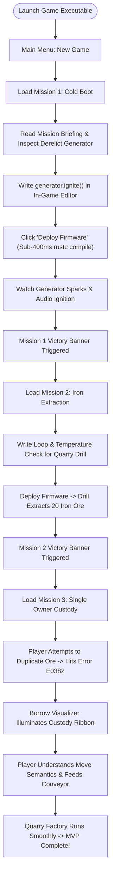

# Rustbound: MVP Engineering Specification

**Document ID:** `SPEC-001`  
**Status:** APPROVED FOR MVP IMPLEMENTATION  
**Version:** 1.0.0  
**Target Date:** November 2026  
**Parent Document:** [01-TECHNICAL-ARCHITECTURE-LOCK.md](file:///home/prajith/Rustbound/docs/architecture/01-TECHNICAL-ARCHITECTURE-LOCK.md)

---

## 1. MVP Objectives

The Minimum Viable Product (MVP) of **Rustbound: The Systems Frontier** has one central technical and experiential objective:

> **Prove the core gameplay loop:** A player opens a mission on Aethelgard, inspects a broken or inert industrial machine, writes standard Rust code in an in-game editor, compiles it with the official Rust compiler (`rustc`), resolves borrow-checker and type errors with visual assistance, deploys the resulting WebAssembly firmware to the machine, and watches the physical automation system execute deterministically in real time.

### Success Criteria:
1. End-to-end latency from clicking "Deploy Firmware" to machine movement is **under 500 milliseconds**.
2. Standard Rust compiler diagnostics (`E0382`, `E0502`, `E0308`) are parsed into interactive editor squiggles and visual ownership ribbons.
3. Player firmware executes inside an isolated Wasmi interpreter with strict fuel limits, never hanging or crashing the game process.
4. Players successfully complete three progressive learning missions demonstrating mastery of functions, loops/mutability, and Rust's ownership/borrowing custody model.

---

## 2. MVP Boundaries: Included vs. Deferred

```
MVP Scope Boundary:
┌────────────────────────────────────────────────────────────────────────┐
│ INCLUDED IN MVP                                                        │
│ • Single Playable Environment: Dropship Bay & Rusted Quarry            │
│ • Core Machines: Quarry Drill, Conveyor Belt, Storage Bay, Gantry Crane│
│ • Official Rust Compiler (rustc) Integration via wasm32-unknown-unknown│
│ • Deterministic Wasmi Runtime with Instruction Fuel Metering (50k/tick) │
│ • In-Game Code Editor (ropey text buffer + tree-sitter highlighting)   │
│ • Borrow Visualizer (Physical Custody Ribbon for E0382 & E0502)        │
│ • Three Linear Missions: Cold Boot, Iron Extraction, Single Custody    │
│ • Deterministic Headless Simulation (20 Hz Fixed Timestep)             │
│ • Local Save/Load System (World State + Firmware Sources)              │
│ • Basic Industrial SFX & Visual Feedback (Drill sparks, belt motion)   │
└────────────────────────────────────────────────────────────────────────┘
┌────────────────────────────────────────────────────────────────────────┐
│ DEFERRED POST-MVP                                                      │
│ ✕ Multiplayer / Co-op Automation (Premature complexity for single-loop)│
│ ✕ Steam Workshop / Modding API (Requires locked stable SDK ABI)        │
│ ✕ Global Leaderboards & Cloud Telemetry (Infrastructure overhead)      │
│ ✕ Full Async/Await Runtime Integration (Too steep for initial learning)│
│ ✕ Full Planetary Campaign / Open World (Linear quarry validates loop)  │
│ ✕ Embedded rust-analyzer Language Server (Memory bloat on 8GB laptops) │
│ ✕ Complex Procedural World Generation (Static quarry gives exact tests)│
│ ✕ Multi-Axis Articulated Robotics (Gantry crane proves kinematic model)│
│ ✕ Multi-Language Localization (English-first technical curriculum)     │
└────────────────────────────────────────────────────────────────────────┘
```

### Rationale for Deferred Items:
- **Multiplayer:** Introduces network replication, rollback determinism, and distributed cheating vectors without validating whether solo Rust programming is fun.
- **Embedded `rust-analyzer`:** Violates the 8GB RAM minimum system requirement; standard `rustc` JSON diagnostics satisfy 95% of educational needs.
- **Async/Await:** Learning Rust begins with ownership, borrowing, and basic types; introducing `Future`, `Pin`, and executors in the first three missions creates an impossible learning curve.

---

## 3. Functional Requirements

### 3.1 Compiler Subsystem Requirements

| Req ID | Title | Priority | Dependencies | Implementation Details | Acceptance Criteria | Verification Method |
| :--- | :--- | :---: | :--- | :--- | :--- | :--- |
| **COMP-001** | Real `rustc` Compilation | P0 | Toolchain | Spawn `rustc` targeting `wasm32-unknown-unknown` linking precompiled `rustbound_api.rlib`. | Generates valid Wasm module from valid player code in < 400ms. | Automated test compiling sample player script against SDK. |
| **COMP-002** | Structured JSON Diagnostics | P0 | COMP-001 | Parse `--error-format=json` into file spans, line/col numbers, error codes, and suggested fixes. | UI displays red squiggles at exact character offsets matching compiler output. | Test matching rustc JSON output against parsed `RustcDiagnostic` structs. |
| **COMP-003** | Compiler Subprocess Quotas | P0 | COMP-001 | Enforce 1GB RAM cap and 5,000ms execution timeout via OS job limits (`setrlimit` / Job Objects). | Infinite macro expansion or deep type recursion killed cleanly at 5.0s. | Subprocess benchmark test with malicious recursive macro bomb. |
| **COMP-004** | Fast Metadata Syntax Check | P1 | COMP-002 | Run `rustc --emit=metadata` on debounced (500ms) editor typing to update diagnostics without full codegen. | Syntax feedback updates in < 200ms while typing. | Automated latency measurement of metadata check pass. |

### 3.2 Runtime Subsystem Requirements

| Req ID | Title | Priority | Dependencies | Implementation Details | Acceptance Criteria | Verification Method |
| :--- | :--- | :---: | :--- | :--- | :--- | :--- |
| **VM-001** | Fuel-Metered Execution | P0 | None | Configure Wasmi store with 50,000 instruction fuel limit per 20 Hz simulation tick. | Unbounded `loop {}` in firmware halts at 50k fuel without freezing host. | Test executing infinite loop; assert host tick completes in < 2ms. |
| **VM-002** | Guest Memory Bounds | P0 | None | Bound Wasmi linear memory to 16 initial pages (1MB) and 64 max pages (4MB). | Memory allocation attempts beyond 4MB trigger graceful VM trap. | Test guest module executing large heap allocation. |
| **VM-003** | Trap Isolation | P0 | None | Catch Wasmi traps (`Unreachable`, `IntegerOverflow`, `OutOfFuel`) in host without panicking. | Crashed firmware transitions machine to "Fault" state in UI. | Deploy panic-inducing bytecode; assert host simulation continues running. |
| **VM-004** | Zero System Call Access | P0 | None | Host provides zero WASI imports; only 4 custom C-ABI machine imports registered. | Attempts to access filesystem, network, or clock fail link/compile time. | Audit Wasm import section; verify absence of `wasi_*` namespaces. |

### 3.3 Simulation Subsystem Requirements

| Req ID | Title | Priority | Dependencies | Implementation Details | Acceptance Criteria | Verification Method |
| :--- | :--- | :---: | :--- | :--- | :--- | :--- |
| **SIM-001** | Fixed 20 Hz Timestep | P0 | None | `bevy_ecs` schedule running at exactly 50ms intervals. | 1,200 ticks advance per real-time minute regardless of display refresh rate. | CI timing test verifying tick rate stability over 60 seconds. |
| **SIM-002** | Integer Spatial Model | P0 | None | Grid tiles (`TileCoord(i32, i32, i32)`) and conveyor progress (`SubTileProgress(u32)`). | Zero IEEE-754 floats in `rustbound_sim` state components. | Clippy lint `#![deny(clippy::float_arithmetic)]` passes cleanly. |
| **SIM-003** | Deterministic Replay | P0 | SIM-001, SIM-002 | All random numbers derived from mission seed + tick count; topological machine order. | 5,000-tick run produces identical state hash across Windows and Linux. | Hash comparison test running headlessly on multiple platforms. |
| **SIM-004** | Rolling Snapshot Buffer | P1 | SIM-001 | Ring buffer storing last 60 ticks of world state for instant player undo/rewind. | Player can step backward up to 3 seconds tick-by-tick without hitching. | Benchmark testing snapshot capture and restoration latency (< 1ms). |

### 3.4 Gameplay & Mission Requirements

| Req ID | Title | Priority | Dependencies | Implementation Details | Acceptance Criteria | Verification Method |
| :--- | :--- | :---: | :--- | :--- | :--- | :--- |
| **GAME-001** | Machine Actuation | P0 | VM-001, SIM-001 | Host applies valid FFI actuator commands to machine ECS components. | Quarry drill extracts ore; conveyor transports items; storage accumulates items. | Integration test asserting entity state changes after command dispatch. |
| **GAME-002** | Physical Custody Token | P0 | GAME-001 | SDK models `ResourceChunk<T>` as affine linear type; transferring moves ownership. | Calling `conveyor.feed(ore)` consumes `ore`; reuse triggers compiler `E0382`. | Test compiling player code attempting to duplicate ore token. |
| **GAME-003** | Mission Progression | P1 | GAME-001, UI-001 | Missions evaluate objective predicates (e.g., "Deposit 50 Iron Ore"). | Mission completion banner triggers when objectives are satisfied. | Automated mission evaluation test suite. |

### 3.5 UI & Presentation Requirements

| Req ID | Title | Priority | Dependencies | Implementation Details | Acceptance Criteria | Verification Method |
| :--- | :--- | :---: | :--- | :--- | :--- | :--- |
| **UI-001** | Dockable Editor Layout | P0 | None | `bevy_egui` + `egui_dock` layout with Viewport, Editor, Diagnostics, and Inspector. | Panes can be resized, docked, and tabbed without graphical artifacts. | Visual rendering test and interaction smoke test. |
| **UI-002** | Code Editor Buffer | P0 | None | `ropey` text buffer with syntax highlighting via `tree-sitter-rust`. | Supports smooth editing, selection, copy/paste, and undo/redo. | Editor buffer unit tests for typing, deletion, and cursor navigation. |
| **UI-003** | Borrow Visualizer Ribbon | P1 | COMP-002, UI-002 | Render visual connection curves between moved variable span and subsequent use span. | Visual ribbon links the source line of custody transfer to the error line. | UI test validating span coordinate transformation to screen coordinates. |

---

## 4. Machine API Specification (`rustbound_api`)

The player writes standard Rust targeting the `rustbound_api` crate. The API is `#![no_std]` compatible, zero-cost, and completely free of `unsafe` code for the player.

### 4.1 Prelude Imports
Every player program begins with:
```rust
#![no_std]
use rustbound_api::prelude::*;
```

### 4.2 Quarry Drill (`QuarryDrill`)
```rust
pub struct QuarryDrill {
    id: u32,
}

impl QuarryDrill {
    /// Binds to a drill actuator by machine ID.
    pub fn bind(id: u32) -> Result<Self, DeviceError>;

    /// Returns telemetry status (temperature, operational status, fault code).
    pub fn status(&self) -> DrillStatus;

    /// Attempts to extract an ore chunk from the mineral vein.
    /// Returns an owned linear resource token representing physical custody.
    pub fn extract(&self) -> Result<ResourceChunk<IronOre>, MachineError>;
}
```

### 4.3 Conveyor Belt (`ConveyorBelt`)
```rust
pub struct ConveyorBelt {
    id: u32,
}

impl ConveyorBelt {
    pub fn bind(id: u32) -> Result<Self, DeviceError>;

    /// Queries the sensor state at the conveyor's intake slot.
    pub fn is_intake_clear(&self) -> bool;

    /// Feeds an extracted resource chunk onto the belt.
    /// CONSUMES the ResourceChunk token by value, transferring custody!
    pub fn feed<T: ResourceKind>(&self, item: ResourceChunk<T>) -> Result<(), MachineError>;
}
```

### 4.4 Storage Bay (`StorageBay`)
```rust
pub struct StorageBay {
    id: u32,
}

impl StorageBay {
    pub fn bind(id: u32) -> Result<Self, DeviceError>;

    /// Deposits a resource chunk into secure storage.
    /// CONSUMES the ResourceChunk token by value!
    pub fn deposit<T: ResourceKind>(&self, item: ResourceChunk<T>) -> Result<(), MachineError>;

    /// Returns the current quantity of stored resources.
    pub fn stored_count(&self) -> u32;
}
```

### 4.5 Transfer Crane (`TransferCrane`)
```rust
pub struct TransferCrane {
    id: u32,
}

impl TransferCrane {
    pub fn bind(id: u32) -> Result<Self, DeviceError>;

    /// Moves the crane trolley to target grid coordinates.
    pub fn move_to(&self, x: i32, y: i32) -> Result<(), MachineError>;

    /// Grabs an item from the current position.
    pub fn grab(&self) -> Result<ResourceChunk<IronOre>, MachineError>;

    /// Releases the held item into target container.
    pub fn release(&self, item: ResourceChunk<IronOre>) -> Result<(), MachineError>;
}
```

### 4.6 Complete Example Player Program
```rust
#![no_std]
use rustbound_api::prelude::*;

#[no_mangle]
pub extern "C" fn firmware_main() {
    let drill = QuarryDrill::bind(0).expect("drill-0 unreachable");
    let conveyor = ConveyorBelt::bind(1).expect("belt-1 unreachable");

    loop {
        // Only extract if conveyor intake has an empty slot
        if conveyor.is_intake_clear() {
            match drill.extract() {
                Ok(ore) => {
                    // Physical custody of `ore` transferred to the conveyor
                    let _ = conveyor.feed(ore);
                }
                Err(MachineError::ThermalOverheat) => {
                    // Cool-down cycle: yield ticks to let heat dissipate
                    rustbound_api::yield_tick();
                }
                Err(_) => {}
            }
        }

        // Relinquish remaining fuel for this 20 Hz simulation tick
        rustbound_api::yield_tick();
    }
}
```

---

## 5. Initial Missions Specification

### Mission 1: Cold Boot
- **Narrative Context:** You have landed at Dropship Bay Alpha on Aethelgard. The main auxiliary generator is cold and unresponsive. A primary telemetry probe must be booted and calibrated to establish base power.
- **Learning Objectives:**
  1. Rust program entry point structure (`firmware_main`).
  2. Calling basic functions and binding machine handles.
  3. Immutable variables and method calls.
- **Initial Environment:**
  - One stationary generator unit (`MachineId = 0`).
  - No active moving parts.
  - Objective: Connect to generator, set power cycle to nominal, and verify ignition.
- **Starter Code:**
  ```rust
  #![no_std]
  use rustbound_api::prelude::*;

  #[no_mangle]
  pub extern "C" fn firmware_main() {
      // Mission 1: Initialize the auxiliary generator.
      // 1. Bind to Generator 0.
      // 2. Call generator.ignite().
  }
  ```
- **Expected Solution Behavior:**
  ```rust
  #![no_std]
  use rustbound_api::prelude::*;

  #[no_mangle]
  pub extern "C" fn firmware_main() {
      let generator = Generator::bind(0).expect("failed to bind generator");
      generator.ignite().expect("ignition failed");
  }
  ```
- **Common Mistakes & Compiler Errors:**
  - Omitting `let`: `generator = Generator::bind(0);` -> `error[E0425]: cannot find value 'generator' in this scope`.
  - Forgetting return check: Compiler warning `unused Result that must be used`.
- **Automated Verification:** Simulation asserts `Generator(0).is_ignited == true` within 10 ticks.

---

### Mission 2: Iron Extraction
- **Narrative Context:** Power is restored. The Rusted Quarry contains an uncalibrated excavator drill positioned over an exposed surface seam of magnetic iron ore. You must program an automated extraction loop that extracts 20 chunks of ore while respecting drill thermal thresholds.
- **Learning Objectives:**
  1. Mutable variables (`let mut`).
  2. Iteration with loops (`loop`, `while`).
  3. Conditional branching (`if`, `match`).
  4. Yielding execution across simulation ticks (`yield_tick()`).
- **Initial Environment:**
  - Quarry Drill (`MachineId = 0`) positioned over iron seam.
  - Drill heats up by 5°C on every extraction; maximum operational temperature is 80°C.
  - Drill cools down by 2°C per idle simulation tick.
- **Starter Code:**
  ```rust
  #![no_std]
  use rustbound_api::prelude::*;

  #[no_mangle]
  pub extern "C" fn firmware_main() {
      let drill = QuarryDrill::bind(0).expect("drill not found");
      // TODO: Extract 20 chunks of ore without overheating the drill.
  }
  ```
- **Expected Solution Behavior:**
  ```rust
  #![no_std]
  use rustbound_api::prelude::*;

  #[no_mangle]
  pub extern "C" fn firmware_main() {
      let drill = QuarryDrill::bind(0).expect("drill not found");
      let mut extracted_count = 0;

      while extracted_count < 20 {
          let temp = drill.status().temperature_celsius;
          if temp < 70 {
              if let Ok(_ore) = drill.extract() {
                  extracted_count += 1;
              }
          }
          // Always yield tick to allow cooling and advance simulation
          rustbound_api::yield_tick();
      }
  }
  ```
- **Common Mistakes & Compiler Errors:**
  - Forgetting `mut`: `let extracted_count = 0; extracted_count += 1;` -> `error[E0384]: cannot assign twice to immutable variable`.
  - Forgetting `yield_tick()`: Consumes all 50k fuel in a single tick; UI shows "Firmware Fuel Starvation Warning".
- **Automated Verification:** Simulation asserts `drill.total_extracted >= 20` and `drill.overheat_count == 0`.

---

### Mission 3: Single Owner Custody
- **Narrative Context:** Raw ore cannot be left on the quarry floor. An automated conveyor belt must transport ore from the drill intake to Storage Bay Alpha. If ore is dropped or duplicated, the quarry logistics grid triggers a critical custody alarm.
- **Learning Objectives:**
  1. Structs and linear types.
  2. Rust **Move Semantics** and ownership transfer.
  3. Understanding borrow errors (`E0382: use of moved value`).
  4. Using references (`&`) vs owned values.
- **Initial Environment:**
  - Quarry Drill (`MachineId = 0`).
  - Conveyor Belt (`MachineId = 1`).
  - Storage Bay (`MachineId = 2`).
  - Belt connects Drill output directly to Storage Bay.
- **Starter Code:**
  ```rust
  #![no_std]
  use rustbound_api::prelude::*;

  #[no_mangle]
  pub extern "C" fn firmware_main() {
      let drill = QuarryDrill::bind(0).expect("drill not found");
      let conveyor = ConveyorBelt::bind(1).expect("belt not found");

      loop {
          if let Ok(ore) = drill.extract() {
              // TODO: Transfer physical custody of ore to the conveyor.
              // WARNING: Do NOT attempt to feed the same ore twice!
          }
          rustbound_api::yield_tick();
      }
  }
  ```
- **Expected Solution Behavior:**
  ```rust
  #![no_std]
  use rustbound_api::prelude::*;

  #[no_mangle]
  pub extern "C" fn firmware_main() {
      let drill = QuarryDrill::bind(0).expect("drill not found");
      let conveyor = ConveyorBelt::bind(1).expect("belt not found");

      loop {
          if conveyor.is_intake_clear() {
              if let Ok(ore) = drill.extract() {
                  // Custody of `ore` moves into conveyor.feed()!
                  let _ = conveyor.feed(ore);
              }
          }
          rustbound_api::yield_tick();
      }
  }
  ```
- **Deliberate Learning Obstacle (The Borrow Error):**
  If a player attempts to inspect or feed the same ore to two devices:
  ```rust
  let ore = drill.extract().unwrap();
  conveyor.feed(ore);
  backup_conveyor.feed(ore); // Compiler rejects!
  ```
  The compiler outputs:
  ```text
  error[E0382]: use of moved value: `ore`
    --> src/main.rs:12:30
     |
  10 |     let ore = drill.extract().unwrap();
     |         --- move occurs because `ore` has type `ResourceChunk<IronOre>`, which does not implement `Copy`
  11 |     conveyor.feed(ore);
     |                   --- value moved here
  12 |     backup_conveyor.feed(ore);
     |                          ^^^ value used here after move
  ```
  **Borrow Visualizer Response:** The in-game IDE draws an illuminated custody ribbon originating at line 11 (where custody was transferred to `conveyor`) and terminating at line 12 with an explanatory tooltip:  
  *"Physical Conservation Law: ResourceChunk<IronOre> was physically loaded onto Conveyor 1. You no longer hold custody of this item."*
- **Automated Verification:** Storage Bay 2 accumulates 30 iron ore chunks without any conveyor jamming or custody fault events.

---

## 6. In-Game UI Specification & Wireframes

### 6.1 Screen Layout & Docking Architecture

The user interface uses `egui_dock` divided into four primary docking regions:

```
┌──────────────────────────────────────────────────────────────────────────────────┐
│  RUSTBOUND // MISSION 3: SINGLE OWNER CUSTODY                    [PAUSE] [1x] [4x] [STEP] [RESET]│
├─────────────────────────────────────────┬────────────────────────────────────────┤
│ [3D SIMULATION VIEWPORT]                │ [IN-GAME CODE EDITOR: main.rs]         │
│                                         │ 1  #![no_std]                          │
│                                         │ 2  use rustbound_api::prelude::*;      │
│   [Excavator Drill #0]                  │ 3                                      │
│           │                             │ 4  #[no_mangle]                        │
│           ▼ [Iron Ore Chunk]            │ 5  pub extern "C" fn firmware_main() { │
│   [Conveyor Belt #1] ========> [Storage]│ 6      let drill = QuarryDrill::bind(0)│
│                                         │ 7          .expect("drill unreachable");│
│                                         │ 8      let belt = ConveyorBelt::bind(1)│
│                                         │ 9          .expect("belt unreachable"); │
│                                         │ 10     if belt.is_intake_clear() {     │
│                                         │ 11         if let Ok(ore) = drill...   │
│                                         │ 12             belt.feed(ore);         │
│                                         │ 13         }                           │
│                                         │ 14     }                               │
│                                         │ 15 }                                   │
│                                         ├────────────────────────────────────────┤
│                                         │ [DEPLOY FIRMWARE] [CHECK SYNTAX] [EXTERNAL IDE]│
├─────────────────────────────────────────┼────────────────────────────────────────┤
│ [MACHINE INSPECTOR & INVENTORY]         │ [COMPILER OUTPUT & BORROW VISUALIZER]  │
│ Machine: Conveyor Belt #1               │ Status: BUILD SUCCEEDED (312ms)        │
│ Status: RUNNING                         │ Output: firmware.wasm (8,412 bytes)    │
│ Power Load: 45 kW / 50 kW               │ Memory: 16 Pages (1,048,576 bytes)     │
│ Velocity: 1.0 m/s (Fixed 20 Hz)         │ Active Fuel/Tick: 1,842 / 50,000 units │
│ Current Slot 0: [IronOre #1024]         │                                        │
│ Target Slot 5:  [EMPTY]                 │ [CUSTODY RIBBON]: Ore moved at L12.    │
└─────────────────────────────────────────┴────────────────────────────────────────┘
```

### 6.2 Viewport Controls
- Orbit camera (`bevy_panorbit_camera`): Right-click drag to rotate, middle-click drag to pan, scroll wheel to zoom.
- Machine Selection: Left-click on any 3D machine opens its live telemetry in the Machine Inspector pane.

### 6.3 Simulation Controls
- **Pause/Play (`Spacebar`):** Toggles simulation tick advance.
- **Speed Multipliers (`1x`, `2x`, `4x`):** Adjusts fixed timestep scheduler target rate.
- **Single Step (`F10`):** Advances the simulation by exactly one 50ms tick.
- **Rewind (`Ctrl+Z` / `Rewind Button`):** Steps backward up to 60 ticks from the snapshot ring buffer.

---

## 7. First Playable Experience: Player Journey



---

## 8. Development Milestones & Definition of Done

### Milestone Sequence Matrix

| Milestone | Target Scope | Key Engineering Tasks | Verification Gate |
| :---: | :--- | :--- | :--- |
| **M1** | **Headless Sim Core** | Implement `rustbound_sim` grid, machine state machines, 20 Hz schedule, snapshot ring buffer. | Headless test running 5,000 ticks in < 1s; zero floats; determinism verified. |
| **M2** | **Compiler & Sandbox** | Implement `rustbound_compiler` worker, OS quotas (`setrlimit`/Job Objects), JSON parser. | Test compiling valid script in < 400ms; malicious bombs killed at 5s. |
| **M3** | **Wasmi VM Runtime** | Implement `rustbound_runtime`, fuel metering (50k/tick), C-ABI imports, custody tracker. | Test executing guest bytecode; infinite loop halts safely; memory bounds enforced. |
| **M4** | **Safe SDK & ABI** | Implement `rustbound_api` (`#![no_std]`), `ResourceChunk<T>` linear token, device drivers. | Compile test proving `E0382` occurs upon double-spending resource token. |
| **M5** | **Client & Editor UI** | Implement `rustbound_client`, Bevy viewport, `bevy_egui` docking, `ropey` editor, squiggles. | 60+ FPS on Intel HD 620; smooth typing; diagnostics rendered accurately. |
| **M6** | **Missions 1–3 & Polish** | Implement Missions 1, 2, 3 manifests, visualizer ribbons, SFX, save/load serialization. | Full playthrough from clean launch to Mission 3 complete without errors. |

### Definition of Done for Any Task:
1. All newly introduced code passes `cargo clippy --workspace --all-targets -- -D warnings`.
2. Code is formatted cleanly with `cargo fmt --check`.
3. Unit tests cover all newly added state transitions and edge cases.
4. No IEEE-754 floats introduced into `rustbound_sim`.
5. No memory leaks or unhandled traps in Wasmi runtime.
6. Documentation updated in corresponding architecture document.

---

## 9. MVP Release Gate Checklist

Before signing off on the MVP release build, all items must be verified:

- [ ] **[COMPILE]** Standard `rustc` compiles guest code in < 500 ms on minimum specification hardware (Intel Core i5-7200U, 8GB RAM).
- [ ] **[SECURITY]** Malicious compiler bombs (type recursion, macro expansion) are terminated within 5.0 seconds without host impact.
- [ ] **[SAFETY]** Unbounded loops (`loop {}`) in guest firmware consume 50,000 fuel and yield cleanly without dropping host frame rate.
- [ ] **[DETERMINISM]** 10,000-tick automated test run produces identical state SHA-256 hashes on Windows 11 and Linux.
- [ ] **[MEMORY]** Total game resident memory (RSS) remains under 1,500 MB during active simulation and compilation.
- [ ] **[CURRICULUM]** Missions 1, 2, and 3 can be solved with diverse valid Rust implementations without rigid single-solution lock-in.
- [ ] **[VISUALIZATION]** Compiler error `E0382` draws the physical custody ribbon linking custody move to the subsequent illegal use.
- [ ] **[PERSISTENCE]** World state, machine inventories, and player source code save and reload without corruption.
