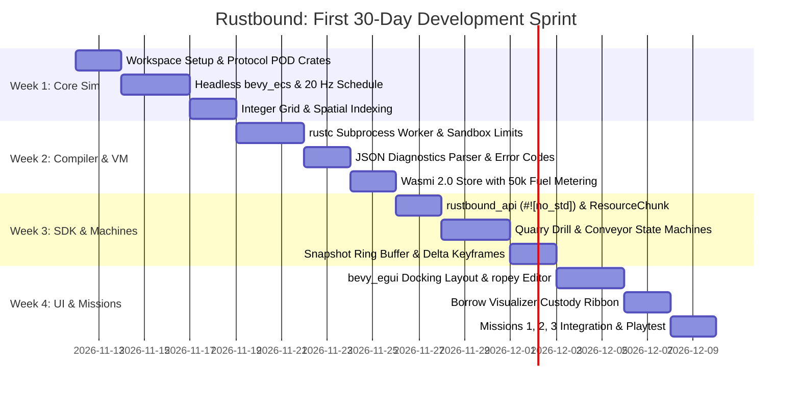

# Rustbound: Implementation Roadmap & Traceability Matrix

**Document ID:** `PLAN-001`  
**Status:** ACTIVE  
**Version:** 1.0.0  
**Target Date:** November 2026  
**Parent Documents:** [01-TECHNICAL-ARCHITECTURE-LOCK.md](file:///home/prajith/Rustbound/docs/architecture/01-TECHNICAL-ARCHITECTURE-LOCK.md), [02-MVP-ENGINEERING-SPECIFICATION.md](file:///home/prajith/Rustbound/docs/architecture/02-MVP-ENGINEERING-SPECIFICATION.md)

---

## 1. Traceability Matrix

This matrix establishes complete end-to-end traceability connecting high-level **Architectural Decisions (ADRs)** to **MVP Functional Requirements**, their **Concrete Implementation Crates/Modules**, and their **Mandatory Automated Verification Tests**.

| Architecture Decision | MVP Requirement ID | Implementation Module | Source File Path | Automated Verification Test |
| :--- | :--- | :--- | :--- | :--- |
| **ADR-001** (Bevy Engine & Headless `bevy_ecs`) | **SIM-001**, **SIM-002** | `rustbound_sim` Core Scheduler | `crates/rustbound_sim/src/schedule.rs` | `tests/determinism.rs::test_fixed_tick_accuracy` |
| **ADR-001** (Headless Isolation) | **SIM-002** | `rustbound_sim` Grid Model | `crates/rustbound_sim/src/grid/mod.rs` | `tests/headless.rs::test_sim_compiles_without_render` |
| **ADR-002** (Direct `rustc` Invocation) | **COMP-001**, **COMP-004** | `rustbound_compiler` Worker | `crates/rustbound_compiler/src/worker.rs` | `tests/compiler.rs::test_rustc_compiles_valid_script` |
| **ADR-002** (JSON Diagnostics) | **COMP-002** | `rustbound_compiler` Diagnostics | `crates/rustbound_compiler/src/diagnostics.rs` | `tests/diagnostics.rs::test_parse_rustc_json_spans` |
| **ADR-002** (OS Subprocess Sandboxing) | **COMP-003** | `rustbound_compiler` Sandbox | `crates/rustbound_compiler/src/sandbox.rs` | `tests/security.rs::test_compiler_dos_bomb_killed` |
| **ADR-002** (Wasmi Fuel Metering) | **VM-001** | `rustbound_runtime` VM Store | `crates/rustbound_runtime/src/vm.rs` | `tests/runtime.rs::test_wasm_infinite_loop_halts` |
| **ADR-002** (Wasm Memory Limits) | **VM-002** | `rustbound_runtime` Memory Cap | `crates/rustbound_runtime/src/vm.rs` | `tests/runtime.rs::test_wasm_oob_memory_trapped` |
| **ADR-003** (C-ABI FFI & Memory Slices) | **GAME-001**, **VM-004** | `rustbound_runtime` FFI Layer | `crates/rustbound_runtime/src/ffi.rs` | `tests/ffi.rs::test_host_submit_command_slice` |
| **ADR-003** (Physical Custody Move Semantics)| **GAME-002** | `rustbound_api` Linear Tokens | `crates/rustbound_api/src/resource.rs` | `tests/ownership.rs::test_double_feed_rejected_e0382` |
| **ADR-004** (Integer Grid & Zero Floats) | **SIM-002** | `rustbound_sim` Spatial Index | `crates/rustbound_sim/src/grid/coords.rs` | `tests/lints.rs::test_no_floats_in_simulation` |
| **ADR-004** (Topological Conveyor Scheduling)| **GAME-001** | `rustbound_sim` Conveyor System | `crates/rustbound_sim/src/machines/conveyor.rs`| `tests/conveyor.rs::test_conveyor_advance_no_clobber` |
| **ADR-004** (60-Tick Snapshot Ring Buffer) | **SIM-004** | `rustbound_sim` Snapshot Buffer | `crates/rustbound_sim/src/snapshot.rs` | `tests/snapshot.rs::test_ring_buffer_rewind_latency` |
| **ADR-001** (`bevy_egui` Docking Layout) | **UI-001** | `rustbound_client` Docking UI | `crates/rustbound_client/src/ui/dock.rs` | `tests/ui_smoke.rs::test_dock_panes_render` |
| **ADR-002** (`ropey` + `tree-sitter` Editor) | **UI-002** | `rustbound_client` Code Editor | `crates/rustbound_client/src/editor/mod.rs` | `tests/editor.rs::test_ropey_buffer_insert_delete` |
| **ADR-003** (Borrow Visualizer Ribbon) | **UI-003** | `rustbound_client` Visualizer | `crates/rustbound_client/src/visualizers/borrow.rs`| `tests/visualizer.rs::test_span_ribbon_generation` |

---

## 2. 30-Day Tactical Implementation Plan

### Day 1–5: Infrastructure & Simulation Core
- **Day 1:** Initialize Cargo workspace (`rustbound_protocol`, `rustbound_api`, `rustbound_runtime`, `rustbound_compiler`, `rustbound_sim`, `rustbound_client`). Setup CI formatting and Clippy check rules.
- **Day 2:** Implement `rustbound_protocol` POD packet structs (`DrillExtractCommand`, `TelemetryPacket`, `PacketHeader`) using `zerocopy`.
- **Day 3:** Implement `rustbound_sim` headless schedule at 20 Hz (`FixedUpdate` simulation barrier).
- **Day 4:** Implement integer grid model (`TileCoord(i32, i32, i32)`) and conveyor sub-tile fixed-point progress tracker.
- **Day 5:** Unit tests verifying 1,000 headless ticks execute in < 50ms with zero float operations.

### Day 6–12: Compiler Subprocess & Wasmi Runtime
- **Day 6:** Implement `rustbound_compiler` worker spawning `rustc` directly with `--target wasm32-unknown-unknown`.
- **Day 7:** Implement OS sandbox limits (`setrlimit` on Linux, Job Objects on Windows) and 5.0s watchdog kill.
- **Day 8:** Implement JSON diagnostics stream parser (`RustcDiagnostic`, `DiagnosticSpan`, error code extraction).
- **Day 9:** Precompile `librustbound_api.rlib` and configure compiler linking path.
- **Day 10:** Integrate `wasmi` 2.0 with `--features deterministic`. Implement store initialization and fuel budgeting (50,000 units/tick).
- **Day 11:** Implement host foreign functions (`host_query_telemetry`, `host_submit_command`, `host_yield_tick`).
- **Day 12:** Integration tests verifying compiler DoS bombs are terminated and guest infinite loops halt cleanly.

### Day 13–19: Safe SDK & Machine State Machines
- **Day 13:** Implement `rustbound_api` `#![no_std]` crate. Define `ResourceChunk<T>` linear custody token.
- **Day 14:** Implement `QuarryDrill` and `ConveyorBelt` safe drivers. Enforce by-value move semantics in `feed()`.
- **Day 15:** Implement `StorageBay` and `TransferCrane` state machines in `rustbound_sim`.
- **Day 16:** Implement conveyor slot progression algorithm (downstream to upstream topological evaluation).
- **Day 17:** Implement snapshot ring buffer (60-tick rolling RAM buffer) in `rustbound_sim`.
- **Day 18:** Implement keyframe serialization (every 200 ticks) and input command journal.
- **Day 19:** Integration tests verifying multi-machine industrial automation loop headlessly.

### Day 20–26: Presentation Layer & In-Game IDE
- **Day 20:** Implement `rustbound_client` Bevy application entrypoint. Add 3D viewport and orbit camera.
- **Day 21:** Integrate `bevy_egui` and `egui_dock`. Create four-pane docking workspace.
- **Day 22:** Implement code editor using `ropey` text buffer and `tree-sitter-rust` syntax token highlighting.
- **Day 23:** Map `rustc` JSON diagnostic spans to editor line/column coordinates; render red/yellow squiggles.
- **Day 24:** Implement Borrow Visualizer panel; draw quadratic bezier custody ribbons connecting moved spans to error spans (`E0382`).
- **Day 25:** Implement Machine Inspector panel displaying real-time telemetry, temperature, and inventory slots.
- **Day 26:** Connect "Deploy Firmware" UI button to compiler worker and simulation hot-reload channel.

### Day 27–30: Missions Integration, Testing & Release
- **Day 27:** Implement Mission 1 ("Cold Boot") RON configuration, generator machine, and completion triggers.
- **Day 28:** Implement Mission 2 ("Iron Extraction") thermal management and 20-ore extraction criteria.
- **Day 29:** Implement Mission 3 ("Single Owner Custody") conveyor transport, storage checks, and borrow hints.
- **Day 30:** End-to-end playtesting on Windows 11 and Linux; verify RAM usage < 1,500 MB; sign off on MVP release gate.

---

## 3. Unresolved Technical Questions & Prototyping Spikes

While the core architecture is locked, three implementation details require dedicated bench spikes during Weeks 1–2:

### Spike S-01: Windows Job Object Cross-Version Permissions
- **Question:** Does creating a restricted Windows Job Object via the Win32 API require elevated administrator privileges on non-domain Windows 10/11 Home editions?
- **Investigation Spike:** Write a standalone 50-line Rust binary using `windows-sys` that launches a subprocess into an anonymous Job Object with memory and CPU limits. Verify it functions on unprivileged standard user accounts.
- **Fallback Plan:** If Job Objects fail without elevation, enforce timeouts via a host thread watching `std::process::Child` with `wait_timeout` and memory monitoring via `sysinfo`.

### Spike S-02: Delta Memory Page Snapshot Compression
- **Question:** What is the exact CPU and memory bandwidth overhead of diffing Wasmi linear memory pages (16–64 pages = 1MB–4MB) every 20 Hz tick across 100 active machines?
- **Investigation Spike:** Benchmark Wasmi memory dirty-page tracking. Measure whether storing simple XOR deltas of modified 64KB pages keeps tick snapshot latency under 1.0 ms.
- **Fallback Plan:** For the MVP (3 machines), full linear memory copies take only ~30 KB per tick and require zero diffing. Defer dirty-page tracking to post-MVP scale-up.

### Spike S-03: `bevy_egui` Input Interception on Orbit Camera
- **Question:** Does clicking or dragging inside the code editor pane accidentally trigger 3D camera rotation in the underlying Bevy viewport?
- **Investigation Spike:** Verify that `egui::Context::wants_pointer_input()` and `wants_keyboard_input()` properly suppress Bevy input event consumption when hovering or typing in editor docks.
- **Fallback Plan:** Route camera input through an explicit `EguiBlockInput` resource check before updating `Transform`.
